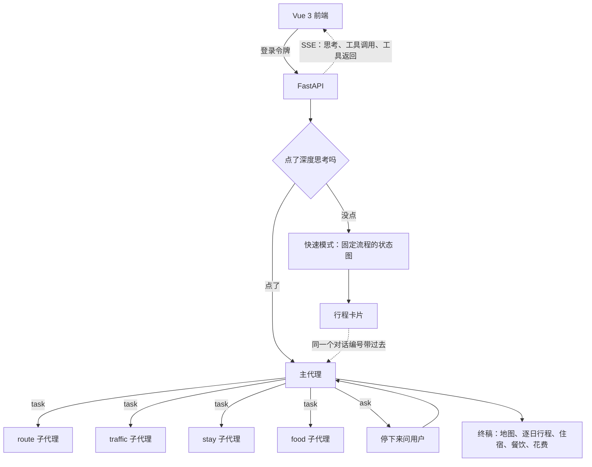

# travel-guide · 智能旅行规划助手

基于 **LangGraph** 和 **Deep Agents** 的多智能体旅行规划系统，后端 FastAPI，前端 Vue 3。用户用一句话说出行程需求，系统查实时的火车票、酒店房价、天气、景点和餐馆，排好每天的路线，生成一份可以直接照着走的行程：怎么去、怎么玩、住哪、吃什么、花多少。

## 功能

- **一句话出行程**：从「下周六从武汉去杭州玩三天，两个人，预算三千」里抽出出发地、目的地、日期、天数、人数和预算，没说的用长期偏好补上
- **日期自动补年份**：没说年份时按今天往后找最近的那一天。今天是 10 月 24 日，说「11 月 5 日」是今年，说「1 月 1 日」是明年
- **实时数据**：12306 余票和当天折扣（商务座、一等座、二等座、无座都列出）、RollingGo 酒店每晚房价、高德景点开放时间和餐馆人均、中国天气网逐日天气
- **人来拍板**：去程车次、回程车次、住哪家酒店、下雨要不要改、超预算怎么办，都停下来给选项让用户选，选完接着跑
- **看得见的思考过程**：深度思考时实时显示主代理和每个子代理的想法、调了哪些工具、传了什么参数、工具返回了什么
- **完整终稿**：高德专属地图链接（每天的路线连成线），逐日行程，每顿饭一家推荐加两家备选，酒店的选择和备选，花费表
- **追问会重查**：终稿之后再问，主代理会重新派子代理去查，不拿旧资料硬答
- **账号与偏好**：注册登录后，口味、忌口、常驻城市、住宿习惯按账号存进数据库，下次出行自动带上；用户可以在「我的偏好」里查看和修改
- **行程按人保存**：深度思考的每一版终稿存进行程表，侧栏只列自己的

## 架构



**快速模式**：一张固定流程的 LangGraph 状态图。依次听懂需求、联网和小红书检索、查天气、写攻略，再由模型自检。资料不够就补搜，写得不好就重写，最多三轮后定稿。

**深度思考模式**：一个主代理指挥四个子代理，每个子代理只管一类工具，查完交回一份短报告，明细不进主对话。

| 子代理 | 负责 | 数据源 |
| --- | --- | --- |
| route | 天气、景点和开放时间、站间交通，按地理位置排出每天的路线并画成地图 | 高德、天气、小红书、Tavily |
| traffic | 往返火车（含中转）和航班，每个席别的余票、原价、折扣和折后价 | 12306、飞常准 |
| stay | 每晚落脚点附近的酒店和每晚房价 | RollingGo、Pilot、高德 |
| food | 每顿饭前后那一站附近的餐馆和人均 | 高德、小红书 |

这是 Supervisor 多智能体：主代理负责任务拆解和汇总，子代理各自执行。顺序是 Plan-and-Execute，先定路线，再并行派出交通、住宿、餐饮。快速模式里的写稿和自检是 Reflection。遇到需要用户拍板的事，用 LangGraph 的 `interrupt` 停下来问，用户回答后用 `Command(resume)` 接着跑。

## 技术栈

- **多智能体**：Supervisor 编排，Plan-and-Execute（先规划再并行执行），Reflection（写稿后自检重写），ReAct 式工具调用
- **智能体框架**：LangGraph（StateGraph、条件路由、`interrupt` / `Command(resume)` 人机协同、`subgraphs` 流式）、Deep Agents（子代理、`task` 派发、中间件按代理收窄工具）
- **记忆与持久化**：PostgreSQL。checkpointer（`PostgresSaver`）保存这一段对话，重启后能接着聊；store（`PostgresStore`）保存跨行程的长期偏好；终稿和用户各一张表。连接池借出前探活，远端掐掉的闲置连接自动换新。不配数据库时退回内存
- **大模型**：DeepSeek（`langchain-deepseek`），工具调用加结构化输出
- **MCP**：自己写的 Streamable HTTP 客户端，按白名单只开放查询类工具，接入 12306、飞常准、RollingGo 酒店、Pilot 酒店、高德地图、小红书。查询失败时降级到下一路数据源或写成待核实
- **服务化**：FastAPI。快速模式一次返回终稿；深度思考用 SSE 推出每一步思考和工具调用，问人时中断，回答后接着跑
- **鉴权**：用户名加密码，PBKDF2 加盐存储，HMAC 签名的令牌（7 天有效）。对话编号、偏好、终稿都按用户隔离，只用标准库，不加依赖
- **前端**：Vue 3（`<script setup>`）+ Vite，手动读 `fetch` 流解析 SSE，`marked` 渲染 Markdown，`DOMPurify` 过滤
- **评测**：按工具轨迹打分，检查四个子代理是否都派到、去程回程和酒店有没有问、终稿有没有地图和折后票价。追踪用 LangSmith，调试用 LangGraph Studio
- **外部接口**：高德 Web 服务 v3 和 v5（地点、周边、路线规划、专属地图）、12306 官方余票接口（当天折扣）、Tavily 搜索、中国天气网和 Open-Meteo
- **工程**：Python 3.11、httpx 异步、Pydantic、psycopg 连接池、Docker

## 目录

```
backend/
├── app/
│   ├── guide/          快速模式
│   │   ├── graph.py    状态图：听懂需求 → 检索 → 天气 → 写稿 → 自检
│   │   ├── node.py     每个节点做的事
│   │   ├── store.py    长期偏好的读写和补空
│   │   └── run.py      命令行运行
│   ├── deep/           深度思考
│   │   ├── agent.py    主代理和四个子代理的提示词、行程卡片
│   │   ├── tools.py    子代理能用的工具
│   │   ├── graph.py    给 Studio 用的图
│   │   └── run.py      命令行运行
│   ├── external/       两种模式共用的外部查询
│   │   ├── mcp_client.py  MCP Streamable HTTP 客户端
│   │   ├── rail.py     12306 车次、中转和当天折扣
│   │   ├── flight.py   飞常准航班
│   │   ├── hotel.py    RollingGo 和 Pilot 酒店
│   │   ├── amap.py     高德地点、周边、路线和专属地图
│   │   ├── food.py     餐馆
│   │   ├── weather.py  天气
│   │   ├── search.py   Tavily
│   │   ├── xhs.py      小红书
│   │   └── price.py    景点开放时间和门票
│   ├── auth.py         注册、登录、令牌
│   ├── dates.py        只说月日时补年份
│   ├── db.py           Postgres：对话存档、长期偏好、终稿
│   ├── service.py      FastAPI 接口和思考过程的 SSE
│   └── eval_trace.py   深度思考的轨迹评测
├── pyproject.toml
├── langgraph.json
└── Dockerfile
frontend/
└── src/
    ├── App.vue                    对话主界面
    ├── api.js                     接口、令牌、SSE 解析
    └── components/
        ├── AuthPage.vue           登录注册
        ├── ThinkingTrace.vue      思考过程和工具调用
        ├── PreferenceDialog.vue   我的偏好
        └── HistoryPanel.vue       已保存的行程
```

## 配置

在 `backend/` 里复制 `.env.example` 为 `.env`，按需填写。除了模型密钥，其余不填就跳过那一路数据源。

| 变量 | 用途 |
| --- | --- |
| `DEEPSEEK_API_KEY` | 模型，必填 |
| `AUTH_SECRET` | 登录令牌的签名密钥，一串长随机字符；不填则每次重启都要重新登录 |
| `AMAP_KEY` | 高德 Web 服务：地图、景点、餐馆、路线 |
| `RAIL_MCP_URL` | 本机 12306 服务，例如 `http://127.0.0.1:8000/mcp` |
| `ROLLINGGO_API_KEY` | RollingGo 酒店房价 |
| `VARIFLIGHT_API_KEY` | 飞常准机票 |
| `TAVILY_API_KEY` | 联网搜索 |
| `XHS_MCP_URL` | 本机小红书服务 |
| `DATABASE_URL` | Postgres，例如 `postgresql://用户:密码@主机:5432/库名`；不填就存内存 |
| `DATABASE_SCHEMA` | 对话存档、偏好和用户表放哪个模式，默认 `travel` |
| `CORS_ORIGINS` | 允许跨域的前端地址，逗号分隔，默认 `http://localhost:5173` |
| `LANGSMITH_*` | 可选，LangSmith 追踪 |

生成 `AUTH_SECRET`：

```powershell
python -c "import secrets; print(secrets.token_hex(32))"
```

用数据库时，终稿表要先建好：

```sql
create table public.travel_guide (
  id          bigserial primary key,
  user_id     text,                 -- 老表没有这一列的话，服务第一次用时会自动补上
  title       text not null,
  destination text,
  summary     text,
  content     text,
  created_at  timestamptz not null default now(),
  updated_at  timestamptz not null default now()
);
```

对话存档、长期偏好和用户表第一次用到时自动建在 `DATABASE_SCHEMA` 里。

## 运行

**后端**

```powershell
cd backend
pip install -e .
copy .env.example .env                  # 填入密钥和数据库
uvx --from mcp-server-12306 mcp-12306   # 另开一个窗口，12306 查票服务
uvicorn app.service:app --port 8080 --reload   # HTTP 服务（12306 已占 8000）
```

**前端**

```powershell
cd frontend
npm install
npm run dev                             # 打开 http://localhost:5173，/api 代理到 8080
```

首次打开先注册一个账号。界面上打开「深度思考」开关走多智能体模式，关着走快速模式。

**其他**（都在 `backend/` 里运行）

```powershell
python -m app.guide.run                 # 命令行跑快速模式
python -m app.deep.run                  # 命令行跑深度思考
langgraph dev                           # 在 Studio 里看两张图
python -m app.eval_trace                # 跑 5 趟真实行程打分，结果写进 eval_results.json
```

## 接口

除 `/health` 和 `/auth/register`、`/auth/login` 外都要带请求头 `Authorization: Bearer <token>`。

| 方法 | 路径 | 说明 |
| --- | --- | --- |
| GET | `/health` | 服务是否在线 |
| POST | `/auth/register` | 注册，`{"username", "password"}`，返回 `{"token", "user"}` |
| POST | `/auth/login` | 登录，同上 |
| GET | `/auth/me` | 当前用户 |
| GET | `/preferences` | 系统记下的长期偏好 |
| PUT | `/preferences` | 整份覆盖偏好 |
| POST | `/guide` | 快速模式，`{"text", "thread_id"}`，一次返回攻略 |
| POST | `/deep/stream` | 深度思考，SSE 流 |
| GET | `/guides` | 自己保存的终稿列表 |
| GET | `/guides/{id}` | 一份终稿的正文，别人的返回 404 |

`/deep/stream` 第一次传 `{"thread_id", "message"}`。同一个 `thread_id` 先走过快速模式的话，会自动带上那张行程卡片。流里的事件：

- `thought`：某个代理（主代理或 route / traffic / stay / food）的思考文字
- `tool_call`：某个代理调了什么工具、传了什么参数，带 `id`
- `tool_result`：对应 `id` 的工具返回（超长截断），`error` 表示是否失败
- `interrupt`：要用户选，带问题和选项，这条流结束
- `done`：终稿正文，和存进数据库后的 `guide_id`

收到 `interrupt` 后，用户选完再调一次，传 `{"thread_id", "resume": "选项原文"}`。
